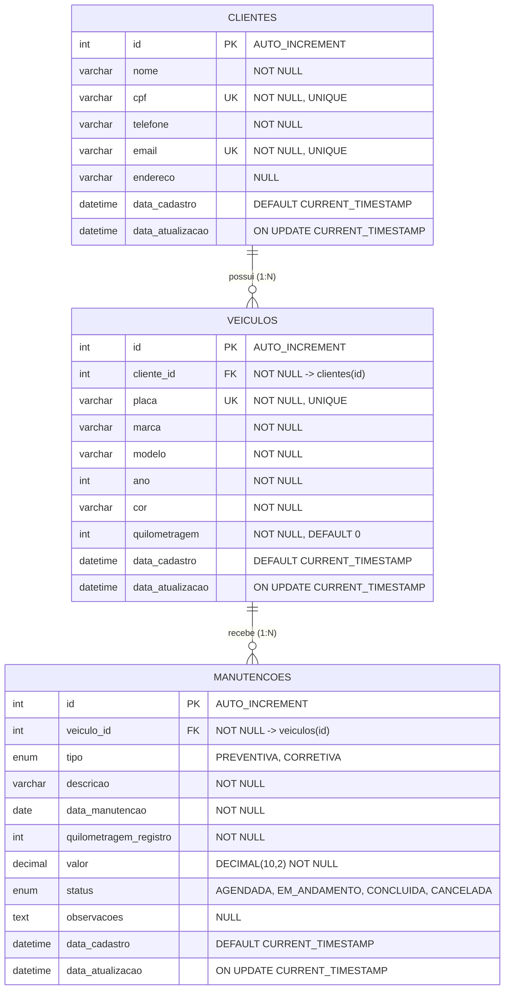

# AutoTrack — Sistema de Gestão de Manutenção Automotiva

---

### Integrantes do Grupo (Equipe de Desenvolvimento)
* **Matheus da Silva Gomes** — RA: **273137** (Autor Principal & Git)
* **Guilherme Coco da Costa** — RA: **272449**
* **Carlos Henrique Beltramo Rodrigues** — RA: **272766**
 
**Repositório Oficial:** [https://github.com/MatheusDev486/autotrack-manutencao-automotiva.git](https://github.com/MatheusDev486/autotrack-manutencao-automotiva.git)

---

## 1. Visão Geral do Projeto

### O Problema
Proprietários de veículos e oficinas mecânicas frequentemente enfrentam desorganização no controle de serviços automotivos: perda de notas fiscais, ausência de registro cronológico da quilometragem nas intervenções, falta de previsibilidade de revisões preventivas e desconhecimento do custo total acumulado por veículo. A falta de um histórico consolidado acarreta prejuízos mecânicos graves e desvalorização patrimonial do automóvel.

### A Solução AutoTrack
O **AutoTrack** é uma solução completa para centralizar a gestão de clientes, veículos e ordens de manutenção (preventivas e corretivas). O sistema garante rastreabilidade total, integridade referencial rígida, alertas visuais de status e relatórios analíticos alimentados diretamente por consultas avançadas em **MySQL 8.x**, calculando o ticket médio de gastos e destacando veículos cujo custo acumulado supera a média da oficina.

---

## 2. Tecnologias Utilizadas

| Camada | Tecnologia | Descrição |
| :--- | :--- | :--- |
| **SGBD** | **MySQL 8.x** / InnoDB | Persistência estritamente relacional, chaves estrangeiras com restrições (`ON DELETE RESTRICT`), índices únicos e compatibilidade total com o modo `ONLY_FULL_GROUP_BY`. |
| **Back-end** | **Node.js 22 + Express** | API REST estruturada em arquitetura Controller-Route, utilizando o driver nativo `mysql2/promise` com **Raw SQL (Prepared Statements)** e tratamento específico de erros como `1451` e `1062`. |
| **Front-end** | **HTML5 + Tailwind CSS + Vanilla JS** | Interface SPA moderna, responsiva e automotiva com tema dark, Fetch API assíncrona, modais de CRUD, badges de status, máscaras de entrada e painel interativo de consultas SQL para a banca. |
| **Versionamento**| **Git & GitHub** | Histórico atômico rigoroso estruturado em 5 commits organizados por camadas de software. |

---

## 3. Modelo de Dados Relacional (DER)

O diagrama abaixo representa a estrutura de tabelas, chaves primárias (PK), chaves estrangeiras (FK), atributos e cardinalidades implementadas no MySQL:



---

## 4. Consultas SQL Obrigatórias para Avaliação

As consultas foram desenvolvidas sem abstrações de ORM, utilizando SQL explícito para máxima transparência acadêmica. Estão documentadas em `database/consultas_avaliacao.sql` e acessíveis na interface pelo **Laboratório SQL**:

### Query 1: Junção Relacional (`INNER JOIN` Multi-Tabelas)
Combina `manutencoes`, `veiculos` e `clientes`, consolidando em uma única visão os dados da ordem de serviço, especificações do veículo e contato do proprietário:
```sql
SELECT 
    m.id AS manutencao_id,
    m.tipo,
    m.descricao,
    DATE_FORMAT(m.data_manutencao, '%d/%m/%Y') AS data_formatada,
    m.valor,
    m.status,
    v.placa,
    v.marca,
    v.modelo,
    c.nome AS proprietario,
    c.telefone
FROM manutencoes m
INNER JOIN veiculos v ON m.veiculo_id = v.id
INNER JOIN clientes c ON v.cliente_id = c.id
ORDER BY m.data_manutencao DESC;
```

### Query 2: Agregação com `GROUP BY` (100% Compatível com MySQL 8 `ONLY_FULL_GROUP_BY`)
Consolida o total de manutenções, o valor acumulado investido e o ticket médio por veículo cadastrado, utilizando `LEFT JOIN` e `COALESCE` para contemplar veículos novos sem manutenções:
```sql
SELECT 
    v.id AS veiculo_id,
    v.placa,
    v.marca,
    v.modelo,
    v.ano,
    c.nome AS proprietario,
    COUNT(m.id) AS total_manutencoes,
    COALESCE(SUM(m.valor), 0.00) AS total_gasto,
    COALESCE(AVG(m.valor), 0.00) AS ticket_medio
FROM veiculos v
INNER JOIN clientes c ON v.cliente_id = c.id
LEFT JOIN manutencoes m ON m.veiculo_id = v.id
GROUP BY 
    v.id,
    v.placa,
    v.marca,
    v.modelo,
    v.ano,
    c.nome
ORDER BY total_gasto DESC;
```

### Query 3: Subconsulta Dinâmica (`Subquery` com `HAVING`)
Identifica dinamicamente os veículos com gasto acumulado **superior à média geral de gastos** entre todos os veículos atendidos na oficina:
```sql
SELECT 
    v.id AS veiculo_id,
    v.placa,
    CONCAT(v.marca, ' ', v.modelo) AS veiculo,
    c.nome AS proprietario,
    COUNT(m.id) AS qtd_servicos,
    SUM(m.valor) AS gasto_acumulado
FROM veiculos v
INNER JOIN clientes c ON v.cliente_id = c.id
INNER JOIN manutencoes m ON m.veiculo_id = v.id
GROUP BY 
    v.id,
    v.placa,
    v.marca,
    v.modelo,
    c.nome
HAVING gasto_acumulado > (
    SELECT AVG(sub.gasto_veiculo)
    FROM (
        SELECT SUM(m2.valor) AS gasto_veiculo
        FROM manutencoes m2
        GROUP BY m2.veiculo_id
    ) AS sub
)
ORDER BY gasto_acumulado DESC;
```

---

## 5. Guia de Instalação e Execução

### Pré-requisitos
* **Node.js** (v18 ou superior)
* **MySQL Server 8.x** (ou MariaDB) rodando localmente na porta 3306

---

### Passo 1: Configuração do Banco de Dados no MySQL

#### Opção A — Pelo MySQL Workbench (Interface Gráfica)
1. Abra o **MySQL Workbench** e conecte-se à sua instância local (`Local instance MySQL80`).
2. Clique no menu **File** -> **Open SQL Script...** (ou `Ctrl + Shift + O`).
3. Selecione o arquivo `database/schema.sql` deste projeto e clique no ícone do **Raio** para executar. Isso criará o banco `autotrack_db` e as tabelas `clientes`, `veiculos` e `manutencoes`.
4. Em seguida, abra o arquivo `database/seed.sql` e execute-o para popular a base com registros realistas para testes.

#### Opção B — Pelo Terminal / PowerShell
Caso o executável do MySQL esteja no seu `PATH` (ou utilize o caminho completo de instalação):
```powershell
# Criação do Schema e Tabelas
mysql -u root -p < database/schema.sql

# Carga de Dados Iniciais (Seed)
mysql -u root -p autotrack_db < database/seed.sql
```
*(No Windows, o executável padrão fica localizado em `C:\Program Files\MySQL\MySQL Server 8.0\bin\mysql.exe`)*.

---

### Passo 2: Configuração das Variáveis de Ambiente (`.env`)

Copie o arquivo de exemplo para o seu arquivo `.env` local:
```powershell
cp .env.example .env
```
Abra o `.env` e configure a senha do seu usuário `root` do MySQL:
```env
PORT=3000
DB_HOST=localhost
DB_PORT=3306
DB_USER=root
DB_PASSWORD=sua_senha_do_mysql
DB_NAME=autotrack_db
```

---

### Passo 3: Instalação das Dependências e Inicialização

Instale os pacotes Node.js e inicie o servidor:
```powershell
# Instala as dependências (express, mysql2, dotenv, cors)
npm install

# Inicia o servidor em produção
npm start

# OU inicia com live-reload para desenvolvimento
npm run dev
```

Abra o seu navegador e acesse a URL:
👉 **`http://localhost:3000`**

---


*AutoTrack — Trabalho Acadêmico Desenvolvido para a Disciplina de Banco de Dados / Engenharia de Software (2026).*
